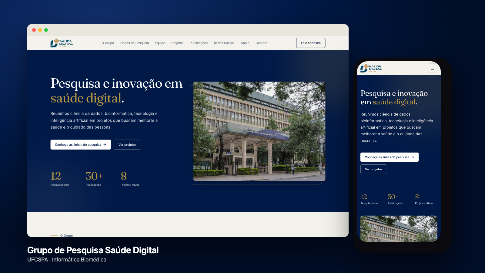
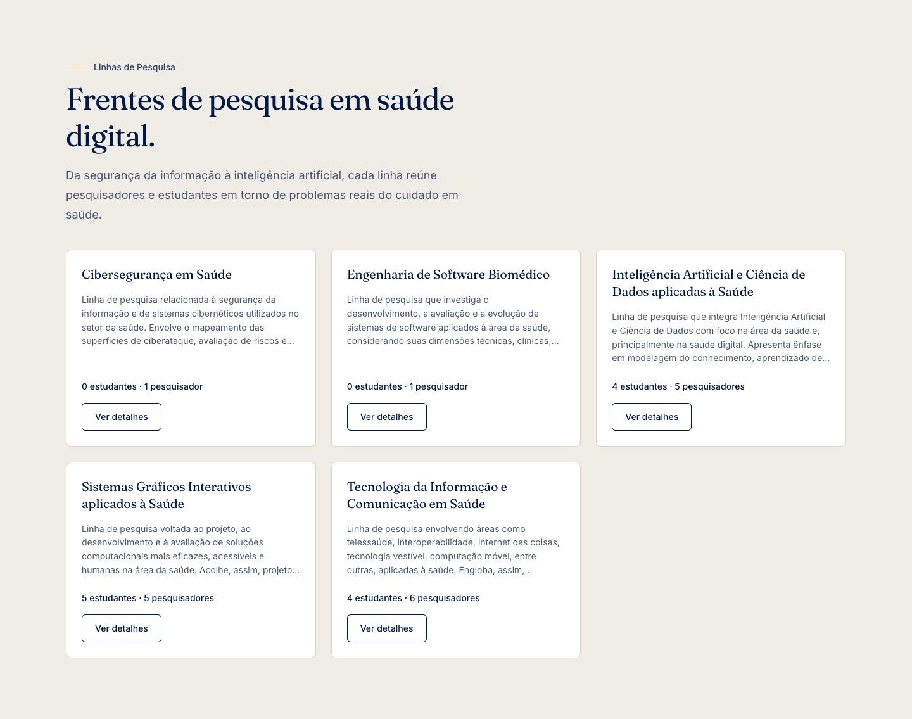
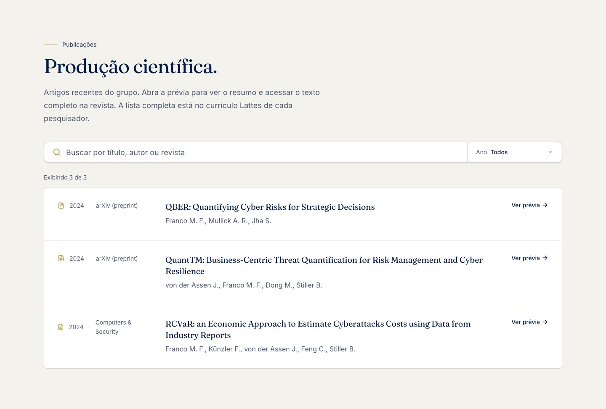

# Site Institucional – Laboratório de Saúde Digital



Site institucional do **Grupo de Pesquisa em Saúde Digital da UFCSPA**, vinculado ao curso de Informática Biomédica. 

O site apresenta o laboratório, sua equipe, linhas de pesquisa, projetos, atividades, publicações e iniciativas.

## Prévia

| Linhas de pesquisa | Publicações |
| :---: | :---: |
|  |  |


## Especificações

- React **(v19)**
- TanStack Start / Router **(v1)**
- Vite **(v8)**
- Tailwind CSS **(v4)**
- TypeScript **(v5.8)**

## O que tem no projeto

Site de página única (*single page*), com menu fixo no topo e design responsivo. As seções são:

- **O Grupo** – apresentação do laboratório
- **Equipe** – membros e seus perfis
- **Linhas de Pesquisa** – áreas de atuação, objetivos e participantes
- **Projetos** – iniciativas em andamento e concluídas
- **Publicações** – produções científicas, com busca, filtro por ano e prévia do resumo
- **Redes Sociais** – postagens recentes do Instagram do grupo
- **Apoio institucional** – instituições que apoiam o grupo
- **Contato** – formas de falar com o grupo

## Guia rápido

Siga essas instruções para instalar as dependências e executar o projeto.

#### Instale as dependências

```
npm install
```

> ⚠️ **Mac e Linux:** se aparecer o erro `EBADPLATFORM` (o `package.json` lista um pacote exclusivo de Windows, `@rolldown/binding-win32-x64-msvc`), rode `npm install --force`. No **Windows** o `npm install` normal funciona.

#### Execute o projeto

```
npm run dev
```

Abra no navegador o endereço exibido no terminal.

🚀 1, 2, 3... Ready!

## Comandos úteis

#### Gerar a versão de produção

```
npm run build
```

#### Aplicar eslint e prettier no código

```
npm run lint
npm run format
```

## Atualização de conteúdo

O conteúdo do site fica em `src/data/`, um arquivo por assunto:

| Arquivo | Conteúdo |
| --- | --- |
| `research-lines.ts` | Linhas de pesquisa e seus participantes |
| `members.ts` | Pesquisadores e estudantes (com link do Lattes) |
| `team.ts`, `projects.ts` | Equipe e projetos |
| `publications.ts` | Publicações (resumo e link da revista) |
| `instagram-posts.ts` | Links das postagens do Instagram |
| `partners.ts` | Instituições de apoio (logotipos em `src/assets/partners/`) |

## Mais informações

- `CLAUDE.md`: estrutura do projeto, nomenclatura e regras de código
- `docs/api/openapi.yaml`: contrato da API (abra no [Swagger Editor](https://editor.swagger.io))
